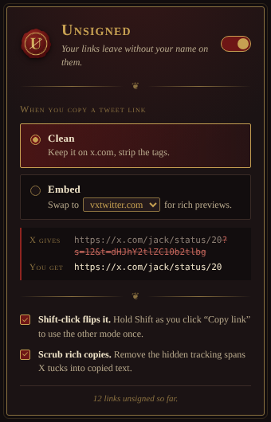

# Unsigned

A Chrome / Brave / Edge extension that strips the sharer-tracking tags X adds to copied tweet links, and can optionally hand you a vxtwitter (or fixvx / fxtwitter / fixupx) link instead.

```
X gives:  https://x.com/CapStasher/status/1984351689248502248?s=12&t=dHJhY2tlZC10b2tlbg
Clean:    https://x.com/CapStasher/status/1984351689248502248
Embed:    https://vxtwitter.com/CapStasher/status/1984351689248502248
```

The `t=` value is a session-bound token that identifies whoever copied the link; `s=` marks the client it came from.

<p align="center"></p>

## Install

1. Download `unsigned-<version>.zip` from [Releases](../../releases) and unzip it into its own folder somewhere permanent.
2. Go to `chrome://extensions` (or `brave://extensions`, `edge://extensions`) and turn on **Developer mode**.
3. **Load unpacked** → pick that folder.
4. Reload any open x.com tabs.

Needs version 111 or later.

## Use

Click **⋯ / Share → Copy link** on a tweet as normal. The toolbar seal flashes **✓** (clean) or **vx** (embed) when a link was rewritten.

- **Mode** — Clean or Embed, from the toolbar popup. Embed service is selectable.
- **Shift-click** "Copy link" to use the other mode for that one copy.
- **Scrub rich copies** — also removes the hidden tracking spans X slips into the HTML side of ordinary text copies.

Embed conversion only happens when the copied thing is a single tweet link. Links inside copied prose are cleaned but stay on x.com.

## How it works

`src/hook.js` runs in the page at `document_start` and wraps every route X can use to write the clipboard: `navigator.clipboard.writeText` / `write`, `clipboardData.setData` inside copy/cut handlers, and plain `execCommand('copy')` of a selected link. The rewrite rules live in `src/rewrite.js`. `src/bridge.js` relays settings in from extension storage (the page context can't read it).

No network requests, no analytics, nothing stored but your settings. Permissions: `storage`, plus access to x.com / twitter.com.

## Building

The repo root loads as-is via **Load unpacked**. To produce the release zip:

```
node build.mjs
```

This writes `dist/unsigned-<version>.zip`. No dependencies.
